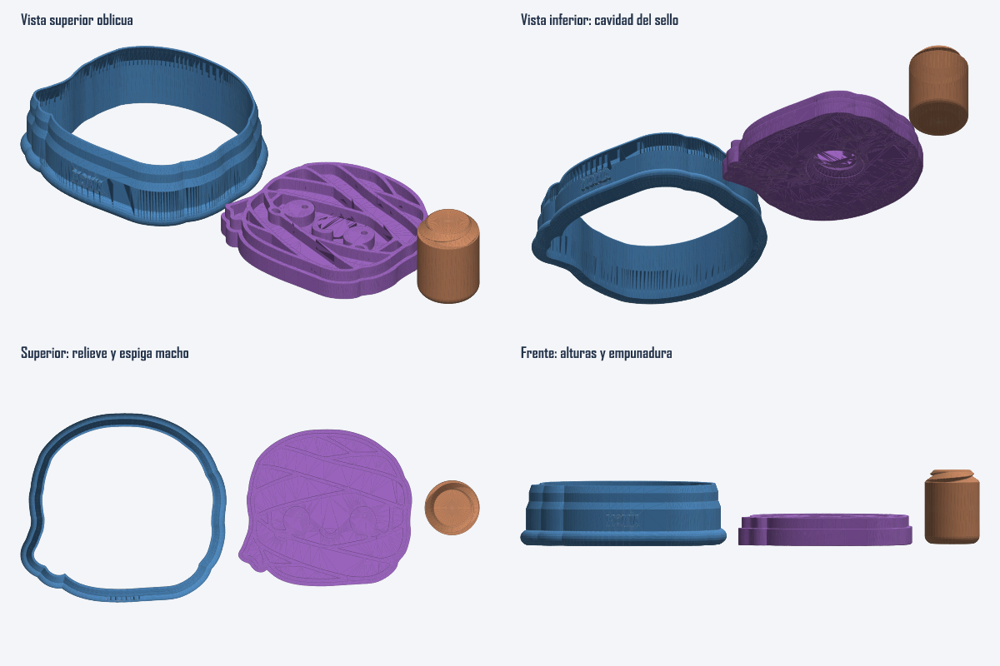

# Análisis geométrico del STL de referencia

Archivo leído sin modificar: `C:/Users/Angy2/Downloads/Captura de pantalla 2026-09-11 234459-cookiecad.stl`.

STL binario, 1,266,784 bytes y 25,334 triángulos. El formato no guarda unidades; las cifras siguientes se interpretan como milímetros porque coinciden con las medidas aportadas por el usuario. No se atribuye ninguna norma de rosca a este archivo.

## Piezas y dimensiones medidas

| Pieza | Límites X | Límites Y | Límites Z | Tamaño XYZ |
|---|---:|---:|---:|---:|
| Cortador | −28.481…28.499 | −26.171…26.171 | 0…16.501 | 56.980 × 52.342 × 16.501 |
| Sello | 31.999…79.999 | −21.671…21.671 | 0…7.500 | 48.000 × 43.341 × 7.500 |
| Mango | 83.749…98.749 | −7.500…7.500 | 0…20.201 | 15.000 × 15.000 × 20.201 |

Las tres piezas están separadas lateralmente para impresión. Las posiciones X son distribución del STL, no desplazamientos que haya que copiar a la geometría funcional.

## Conclusión funcional: sello hembra, mango macho

El sello contiene una cavidad helicoidal que se abre por su cara inferior, en Z=0. No tiene un espárrago macho en su dorso. El mango es una pieza maciza con una espiga helicoidal saliente en su extremo superior. Esto invierte los papeles respecto al sistema anterior de la aplicación.

La placa del sello ocupa Z=0…4.5. El dibujo de marcado sobresale hacia +Z, desde Z=4.5 hasta Z=7.5: altura de relieve medida de 3 mm. La cavidad del dorso llega hasta Z≈4.2; por tanto queda aproximadamente 0.3 mm entre su techo y el plano general Z=4.5. Esa distancia es una medición del archivo, no una recomendación de espesor.

La boca del receptáculo tiene un chaflán amplio. Cerca de Z=0.1 mide aproximadamente 15.2 mm de ancho; a mayor profundidad aparecen los dos lóbulos helicoidales. El centro del receptáculo es aproximadamente [57.713, 0], ligeramente desplazado respecto al centro de la caja del sello [55.999, 0].

El cuerpo del mango termina en Z=17.0; la espiga ocupa Z=17.0…20.201, longitud saliente≈3.201 mm. El cuerpo tiene diámetro 15 mm. Para razonar sobre el ensamblaje, una traslación inicial de −17 mm en Z coloca su hombro en el plano de la boca del sello y su espiga en el intervalo Z=0…3.201; después debe alinearse la fase angular de la hélice. Esto describe orientación y solape nominal, no certifica un ajuste físico.

## Perfil helicoidal medido

Las secciones polares presentan dos lóbulos opuestos. Al aumentar Z 0.25 mm, la fase del segundo armónico cambia aproximadamente −π/6. Eso corresponde a un giro del perfil de +15° cada 0.25 mm, es decir, +60°/mm. La forma observada es coherente con dos entradas helicoidales, avance de aproximadamente 6 mm por vuelta y separación axial de aproximadamente 3 mm entre entradas. El sentido, con el sistema de coordenadas del STL, es compatible con hélice derecha.

Esta inferencia procede del perfil del archivo; no implica rosca métrica ISO, paso normalizado ni compatibilidad con hardware comercial. Es una unión gruesa y corta, muy distinta de un espárrago largo con varias vueltas finas.

| Medida de sección útil | Macho | Hembra |
|---|---:|---:|
| Radio mínimo del perfil | ≈5.29 | ≈5.69 |
| Radio máximo del perfil | ≈7.29–7.30 | ≈7.68–7.70 |
| Diámetro mayor aproximado | ≈14.6 | ≈15.4 |

El conjunto es coherente con un diámetro nominal de 15 mm, reducción radial de unos 0.2 mm en el macho y aumento radial de unos 0.2 mm en la hembra. Así, la diferencia radial entre perfiles emparejados es cercana a 0.4 mm. Es una inferencia que explica las cotas; no se debe interpretar automáticamente el campo «espacio 0.2» como un incremento aplicado únicamente a la hembra.

La punta macho se estrecha claramente: el radio exterior cae hacia≈5.04 mm en Z=20.201. Esa conicidad facilita la entrada. La hembra incorpora el ensanchamiento complementario en la boca.

## Mango y discrepancias con los parámetros de la captura

La altura de cuerpo de 17 mm y el diámetro de 15 mm coinciden con los valores mencionados. El redondeo inferior **medido en el STL** corresponde a radio≈2 mm, no a 4.5 mm: la cara plana Z=0 tiene radio≈5.5; el radio exterior alcanza 7.5 en Z=2. Los puntos del perfil siguen un cuarto de círculo de radio 2, discretizado aproximadamente cada 15°.

La cavidad medida llega a 4.2 mm y la espiga saliente mide 3.201 mm. Por ello no debe afirmarse que la cifra de captura «vaso roscado 3.7» sea directamente la profundidad total del receptáculo o la longitud de espiga de este STL. La captura puede contener ajustes distintos o una convención diferente de medición.

No se aprecia una cavidad de logo en la cara libre redondeada del mango del archivo; esa cara es un disco plano en Z=0. El dibujo que se distingue en la vista superior del mango pertenece a la espiga, no a un grabado superior de marca.

## Cortador

La abertura interior es aproximadamente 50 × 45.341 mm. El contorno de placa del sello es aproximadamente 48 × 43.341 mm: existe alrededor de 1 mm de diferencia por lado entre abertura del cortador y placa del sello, según los ejes principales, después de alinear ambas piezas.

La empuñadura es una banda con sección exterior redondeada, de altura aproximada 4.001 mm. Su ancho máximo exterior se alcanza cerca de Z=2. Por encima sigue una pared vertical gruesa; el perfil se reduce en dos transiciones hacia el borde cortante superior Z=16.501.

En una sección alejada de letras: ancho exterior X≈53.809 en Z=4.5…9.5; ≈52.204 en Z=12.5…14.5; ≈50.877 cerca de Z=16.401. La abertura interior permanece alrededor de 50 mm. Son anchos de sección, no equivalencias exactas a un offset normal sobre cualquier tramo.

El texto está en una cara vertical del exterior, del lado Y negativo. Sobresale aproximadamente 1 mm de la pared; sus superficies visibles principales están aproximadamente entre Z=5.5 y Z=8.5. El anillo de agarre queda debajo, con techo alrededor de Z=4.001. No está acostado en la cara horizontal del anillo.

## Vista reconstruida

La inspección por soldadura de coordenadas detectó cero aristas abiertas y algunas aristas con más de dos incidencias. No se utilizó para reparar ni modificar el archivo aportado, y no constituye una certificación topológica del STL original.
